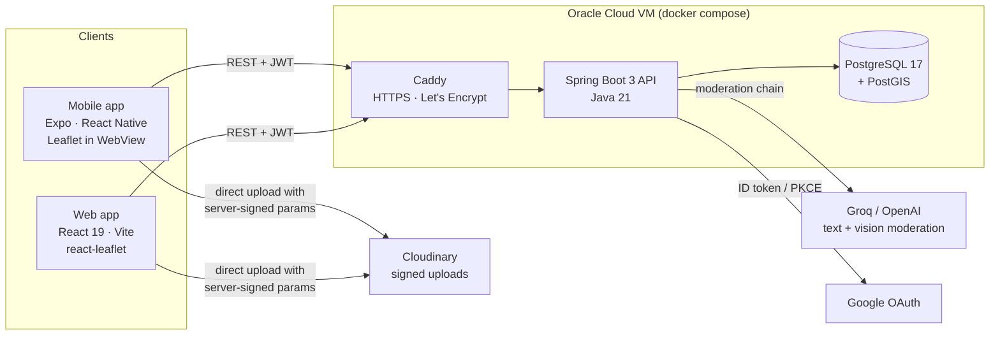

# SkateMap

[](https://github.com/acoder160/PROY_INTERMODULAR_ANDRII_CHAIKA/actions/workflows/ci.yml)

**A community map of skate spots for skaters in a city they don't know.** Spots come in photo-first:
you take the photo on site, pin it inside your GPS radius, then describe it. That way the map only
shows places someone has actually stood at. Anyone can browse; with an account you can add, rate,
comment on and report spots. AI moderation keeps the content clean.

> **Live demo:** _add link_ · press **Try the demo** on the login screen. You don't need an account.

<!-- Screenshots / GIFs: map + clusters, photo-first add flow, spot details, admin swipe moderation -->
<!--  -->

Three clients share one design language and 21 languages, including RTL:
- **Android app** (Expo / React Native)
- **Web app** (React + Vite)
- **Admin moderation**, in both clients

---

## Architecture



| Part | Stack |
|---|---|
| `skatemap/` | Java 21, Spring Boot 3.3 (Web, Security, Data JPA, Validation, Actuator), Hibernate Spatial, Flyway, bucket4j, Caffeine, JUnit 5, Testcontainers |
| `skatemap-mobile/` | Expo SDK, expo-router, TypeScript, Leaflet in a WebView, expo-camera / location / secure-store, i18next |
| `skatemap-web/` | React 19, Vite, react-router, react-leaflet + markercluster, axios, i18next |
| `deploy/` | Docker Compose: PostGIS + API + Caddy on one VM, daily `pg_dump` backups |
| `mcp-server/` | MCP server for seeding real spots (Google Places → Cloudinary → DB) |
| `i18n/` | Master translations for 21 locales, checked and synced into both clients |

---

## Engineering highlights

### Authentication and sessions
- **Short-lived JWT access token (15 min) and rotating refresh tokens (30 days).** Refresh tokens
  are stored as hashes and grouped into token families.
- **Reuse detection.** If someone replays an old refresh token, the server revokes the whole family.
- **"Sign out everywhere"** bumps a `token_version` that every access token is checked against.
- **Refresh token placement:** an HttpOnly `SameSite=Strict` cookie on the web, the body plus
  SecureStore on mobile.
- **Google sign-in** with two flows:
  - an ID-token flow;
  - a browser **PKCE** flow for Expo Go, with a one-time code handed back to the app.
- **Single-flight refresh on the clients.** Parallel refreshes would trip the reuse detection, so
  every caller shares one in-flight request.

### Social layer
- **Profiles, follows, saved spots, threaded comments** (one level of replies) with likes, and
  editing or deleting your own comments and spots.
- **Activity feed, fan-out on read.** Each action is one row in `activities`. The feed is one
  indexed query over the people you follow. Fan-out on write only pays off for accounts with huge
  follower counts; here it would only add writes.
- **Keyset pagination** (`?before=<id>`) for comments, feed and notifications. It stays fast at
  any depth and doesn't skip or repeat items when new ones arrive between pages.
- **Notifications:**
  - The notification row is written in the same transaction as the action that caused it.
  - The push (Expo push service) goes out **after commit**, asynchronously, on its own thread pool.
    A slow push never slows down or rolls back a request.
  - Tokens of uninstalled apps are dropped automatically.
- **Account deletion anonymises the account:**
  - personal data, follows, likes and push tokens are removed;
  - every session is revoked;
  - the user's spots and comments stay, shown as "deleted user".
- **Share links** (`/s/{id}`) serve Open Graph tags, so chats show the spot's photo and name.

### Content moderation
- **Text check:**
  - a local regex filter first (phone numbers, links, banned words);
  - then a chain of LLM providers (Groq → bigger Groq model → OpenAI → safeguard model).
  - If every provider is down the request is blocked (**fail-closed**). Nothing gets through
    unchecked.
- **Photo check:** OpenAI omni-moderation and a vision model. The verdict is `ALLOW`,
  `REJECT`, `UNCLEAR` or `NOT_PLACE` (the photo is not a skate spot).
- **Crowd reports are weighted:**
  - an account younger than a day counts as ½;
  - a reporter whose past reports were mostly rejected counts as 0.
  - When the weight reaches the spot's threshold, the spot hides itself. An AI review of the
    report runs asynchronously.
- **Admin queue** (swipe cards on mobile) with an audit log of every decision.

### Performance and scale
- **Spot list:** served from an in-memory cache (Caffeine, invalidated after commit), with a
  **weak ETag** and gzip. A return visit costs a `304` with no body. The mobile app keeps the list
  and its ETag offline.
- **Geo search:** PostGIS `ST_DWithin` in real metres (`geography`), served by a GIST
  **expression index** on `location::geography`. An `EXPLAIN` test guards the index. A plain
  geometry index can't serve this query, and without the expression index every search would
  scan the whole table.
- **Rate limits:** per user for writes and per client IP for auth (bucket4j, `429` +
  `Retry-After`). The client IP is resolved from the right-most proxy entry, so spoofed
  `X-Forwarded-For` headers can't get around the limits.
- **Load testing:** k6 scripts (`skatemap/loadtest/`) with pass/fail thresholds:
  - p95 under 1.5 s for the first map load;
  - p95 under 300 ms for a 304;
  - p95 under 500 ms for comments;
  - under 1% errors.

### Quality
- **CI on every push:**
  - backend tests, including integration tests on a real PostGIS through **Testcontainers**;
  - Docker image build;
  - web lint and build;
  - mobile type-check and lint.
- **Security tests run the real filter chain:** 401 vs 403, rate limits, spoofed IP headers, and
  that no error details leak.
- **Flyway migrations** with `ddl-auto=validate`. The entity mapping is checked against the real
  schema on startup.

### Demo account
- **Try the demo** gives every visitor a session on a shared account:
  - it goes through the same moderation;
  - it has its own **per-visitor (IP) rate limits**, so one visitor can't use up the budget for
    everyone else;
  - it can't run account-wide actions such as "sign out everywhere".

---

## Run it locally

**Requirements:** Java 21, Node 20+, Docker.

```bash
# 1. Database: PostGIS in Docker
docker run -d --name skatemap-db -p 5432:5432 \
  -e POSTGRES_DB=skatemap -e POSTGRES_USER=skatemap -e POSTGRES_PASSWORD=skatemap \
  postgis/postgis:17-3.5
```

```bash
# 2. API: create skatemap/.env (see deploy/.env.example for every key), then
cd skatemap && ./mvnw spring-boot:run          # http://localhost:8080
```

Minimum `skatemap/.env` for local work:

```properties
SPRING_DATASOURCE_URL=jdbc:postgresql://localhost:5432/skatemap
SPRING_DATASOURCE_USERNAME=skatemap
DB_PASSWORD=skatemap
JWT_SECRET=change-me-to-a-long-random-string-of-at-least-64-characters-0000000000
FRONTEND_URL=http://localhost:5173
CORS_ORIGINS=http://localhost:5173
REFRESH_COOKIE_SECURE=false
DEMO_ENABLED=true
# Needed only to upload photos / run AI moderation:
CLOUDINARY_CLOUD_NAME=
CLOUDINARY_API_KEY=
CLOUDINARY_API_SECRET=
GROQ_API_KEY=
OPENAI_API_KEY=
```

```bash
# 3. Web: http://localhost:5173
cd skatemap-web && npm install && VITE_DEMO_ENABLED=true npm run dev
```

```bash
# 4. Mobile: Expo Go or an emulator (EXPO_PUBLIC_API_URL must point at your machine's LAN IP)
cd skatemap-mobile && npm install && npx expo start
```

Run the tests (the integration tests need Docker running and are skipped without it):

```bash
cd skatemap && ./mvnw verify
```

Production deployment (one VM, HTTPS, backups): [`deploy/README.md`](deploy/README.md).

---

## API overview

| Area | Endpoints |
|---|---|
| Auth | `POST /api/auth/{login,register,google,refresh,logout,logout-all,demo}`, Google browser flow `/api/auth/google/{start,callback,exchange}` |
| Spots | `GET /api/spots` (ETag), `GET /api/spots/nearby`, `POST /api/spots`, `DELETE /api/spots/{id}` (admin) |
| Community | `GET /api/spots/{id}/comments?before=`, `POST /api/comments/{spotId}` (with `parentId` for replies), `PATCH/DELETE /api/comments/{id}`, `POST/DELETE /api/comments/{id}/like`, `POST /api/ratings/{spotId}`, `GET /api/ratings/check/{spotId}`, `POST /api/spots/{id}/reports`, `PATCH/DELETE /api/spots/{id}` (author) |
| Social | `GET/PATCH/DELETE /api/users/me`, `GET /api/users/{username}[/spots\|/followers\|/following]`, `POST/DELETE /api/users/{username}/follow`, `GET /api/feed?before=`, `GET /api/favorites[/spots]`, `PUT/DELETE /api/favorites/{spotId}` |
| Notifications | `GET /api/notifications?before=`, `GET /api/notifications/unread-count`, `POST /api/notifications/read`, `POST /api/push-tokens[/unregister]` |
| Sharing | `GET /s/{id}`: link preview page that sends people on to the map |
| Uploads | `GET /api/cloudinary/signature` |
| Admin | `/api/admin/moderation`, `/api/admin/spots/{id}/{keep,remove,photo}`, `DELETE /api/admin/comments/{id}` |
| Ops | `GET /actuator/health` |

OpenAPI / Swagger UI is available at `/swagger-ui` when `SWAGGER_ENABLED=true`.

---

_SkateMap began as my final project for the 2º DAM course (Desarrollo de Aplicaciones
Multiplataforma) and keeps growing as a portfolio project._ — Andrii Chaika
